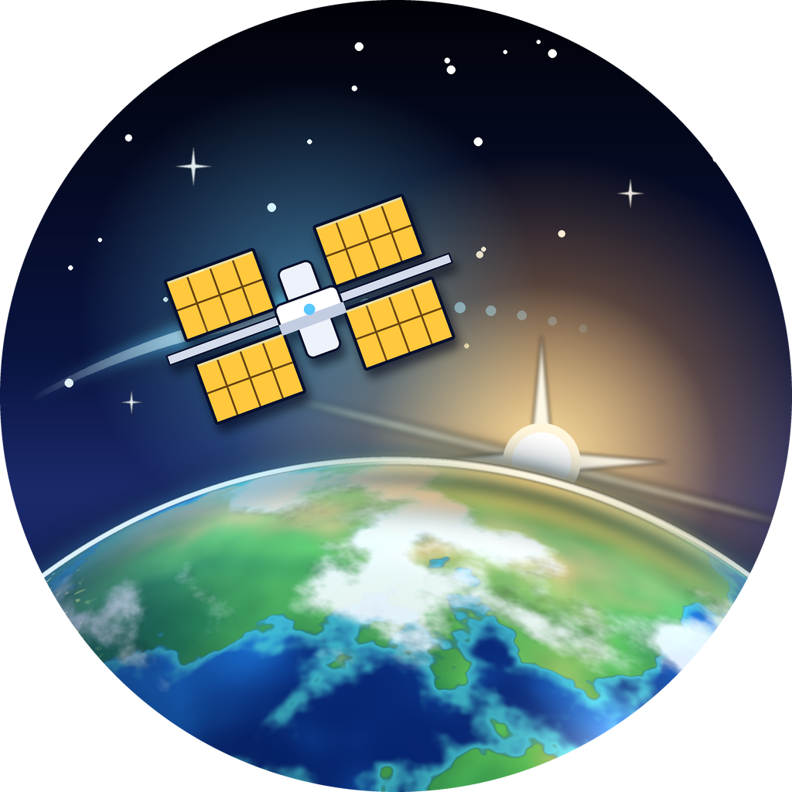
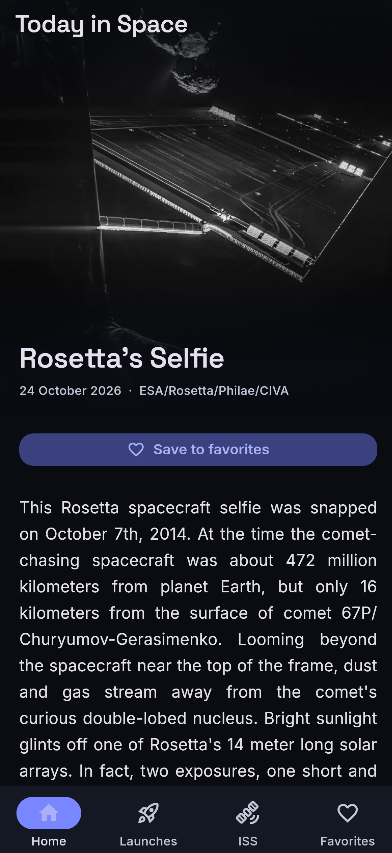
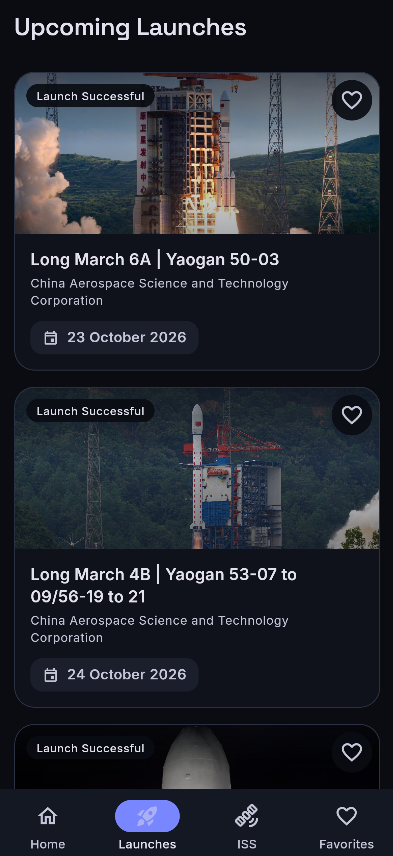
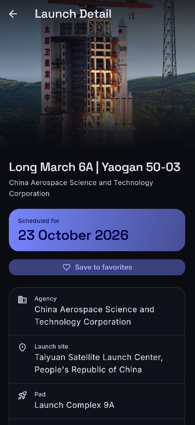
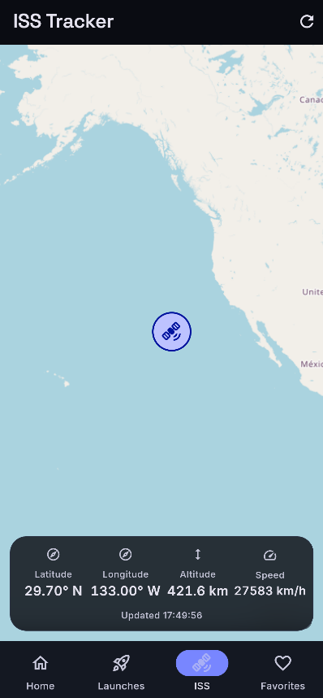
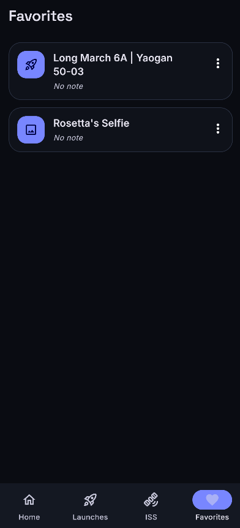
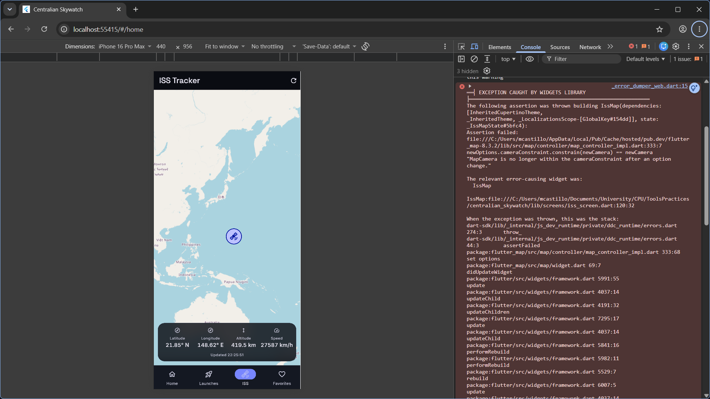

<p align="center">
  
</p>

# Centralian Skywatch [](https://github.com/KabbalahTreeofLife/Centralian_Skywatch/actions/workflows/ci.yml)  

Centralian Skywatch brings NASA's Astronomy Picture of the Day, upcoming
rocket launches, and live ISS tracking together in one Flutter app. Preview
images, play supported APOD videos, and bookmark favorite pictures and
launches with notes that persist across restarts.

Built for **SE2142 — Software Engineering**, Final Project. See the
[project documentation](docs/PROJECT_DOCUMENTATION.md) for screenshots,
architecture, debugging notes, tests, APIs, and release instructions.

## Screenshots

| Home | Launches | Launch details |
| :---: | :---: | :---: |
|  |  |  |

| ISS tracker | Favorites |
| :---: | :---: |
|  |  |

## Installation and setup

Requirements: Flutter 3.44.9 (stable) and Dart 3.12.2.

```powershell
git clone https://github.com/KabbalahTreeofLife/Centralian_Skywatch.git
cd Centralian_Skywatch
Copy-Item .env.example .env
flutter pub get
flutter run
```

`NASA_API_KEY` in `.env` is optional; without it the app uses NASA's
rate-limited `DEMO_KEY`. Get a personal key from the
[NASA API portal](https://api.nasa.gov/). Values in `.env` are bundled into
the application and can be extracted, so do not put secrets in a build you
distribute.

## Usage

Run the app on a connected device or emulator:

```powershell
flutter run
```

Run the automated tests:

```powershell
flutter test
```

## Test summary

The current suite passes **240 tests**. It covers model parsing, API request
and retry behavior, provider state, screen interactions, navigation, and
shared widgets. Network-facing tests use mocked responses. CI also checks
Dart formatting and runs `flutter analyze --fatal-infos` and `flutter test`
on pull requests and pushes to `main`.

## Debugging case: ISS map camera constraint



During mobile viewport testing in Chrome, the map reported
`MapCamera is no longer within the cameraConstraint after an option change.`
The original `CameraConstraint.contain` kept the entire viewport within map
bounds, which restricted the camera center on narrow portrait screens. When
the ISS moved near the longitude edge, the map could not follow correctly and
a later options update triggered the assertion.

The fix uses `CameraConstraint.containCenter`: the camera center stays within
world bounds without requiring the whole viewport to fit. This lets the map
track the ISS near the edge while preserving the map's constraints.

## Contributing

This is an individual course project. Bug reports and suggestions are welcome
through [GitHub Issues](https://github.com/KabbalahTreeofLife/Centralian_Skywatch/issues).
For code changes, open an issue first, then submit a pull request with relevant
tests passing.

## License

No license is currently included in this repository. Contact the maintainer
before reusing or redistributing the project.

## Contact

For questions or support, open a
[GitHub Issue](https://github.com/KabbalahTreeofLife/Centralian_Skywatch/issues)
or contact the maintainer through
[GitHub](https://github.com/KabbalahTreeOfLife).

[**Marco Daniel S. Castillo**](https://github.com/KabbalahTreeofLife) — Solo developer and maintainer.