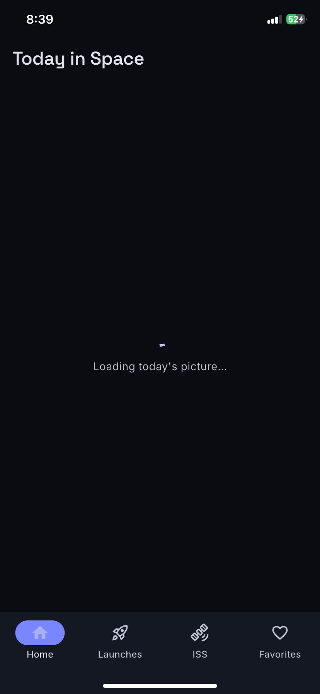
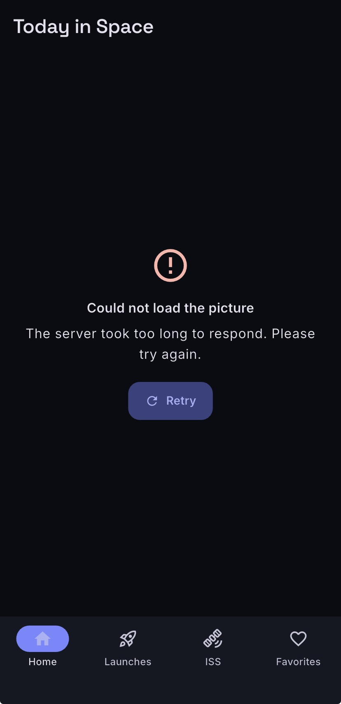
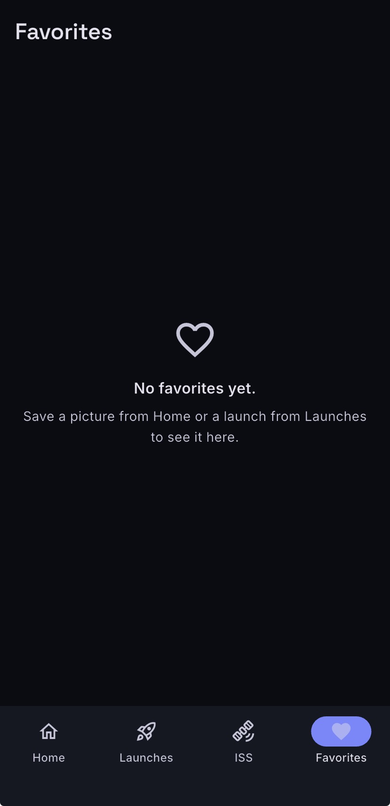
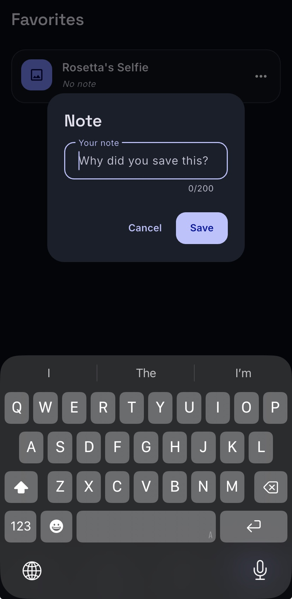
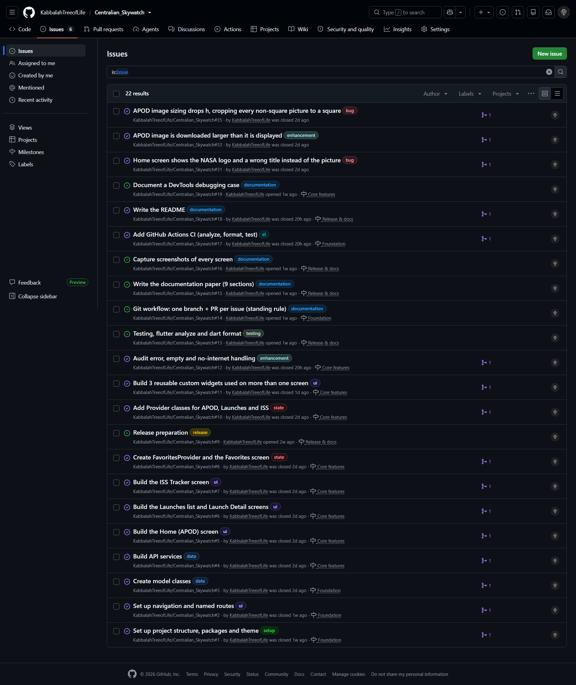

# Centralian Skywatch — Project Documentation

This guide contains the project reference material that complements the concise
[repository README](../README.md): features, screenshots, architecture, APIs,
testing, debugging history, and release instructions.

## Project overview

Centralian Skywatch is a Flutter app that brings NASA's Astronomy Picture of
the Day, upcoming rocket launches, and live ISS tracking together, with
favourites that persist across restarts.

Built for **SE2142 — Software Engineering**, Final Project.

## Features

- **Today's picture** — NASA APOD title, date, explanation, and credit. Video
  entries open as links rather than displaying a broken image.
- **Launch countdowns** — upcoming launches with a live `T-HH:MM:SS`
  countdown.
- **Launch details** — agency, pad, mission type, and status.
- **ISS tracker** — map position plus latitude, longitude, altitude, and
  velocity; refreshes every 15 seconds.
- **Favorites** — save pictures and launches, add notes up to 200 characters,
  and retain them across app restarts.
- **Readable failure states** — offline, timeout, rate-limit, and server errors
  show a useful message and a retry option.

## Screenshots

| Home | Launches | Launch detail |
| :---: | :---: | :---: |
|  |  |  |

| ISS tracker | Favorites |
| :---: | :---: |
|  |  |

### Key states and project tracking

| Home loading | Home error | Empty favorites |
| :---: | :---: | :---: |
|  |  |  |

| Favorite note dialog | GitHub Issues |
| :---: | :---: |
|  |  |

## Project requirements

| Requirement | Implementation |
| --- | --- |
| Screens and navigation | Home, Launches, Launch detail, ISS, Favorites, and NotFound. Named routes pass the selected `Launch` through route arguments. |
| State management | `provider`, with one `ChangeNotifier` per data source and a shared `LoadableProvider`/`LoadStatus` pattern. |
| CRUD and persistence | Favorites support save, list, note updates, and removal; `shared_preferences` retains them across restarts. |
| Form validation | Favorite notes cannot be empty and are limited to 200 characters. |
| REST APIs | NASA APOD, Launch Library 2, and Where the ISS at? |
| Shared state UI | Reusable loading, error/retry, and empty-state widgets provide consistent screen states. |
| Design system | Material 3, bundled Inter and Space Grotesk variable fonts, and a custom color scheme. |

## Installation and configuration

Requirements: Flutter 3.44.9 (stable) or later and Dart 3.12.2.

```powershell
git clone https://github.com/KabbalahTreeofLife/Centralian_Skywatch.git
cd Centralian_Skywatch
Copy-Item .env.example .env
flutter pub get
flutter run
```

The `.env` file is required because it is bundled as an asset. `NASA_API_KEY`
is optional: the project falls back to NASA's `DEMO_KEY`, which is heavily
rate-limited. A personal key can be obtained from <https://api.nasa.gov/>.
Values in `.env` are bundled into the app and can be extracted, so do not put
secrets there in builds you distribute.

| Variable | Required | Purpose |
| --- | --- | --- |
| `NASA_API_KEY` | No | NASA APOD API key; defaults to `DEMO_KEY`. |

## Usage

Run the app on a connected device, emulator, or desktop target:

```powershell
flutter run
```

Run the automated tests:

```powershell
flutter test
```

## Packages

| Package | Version | Purpose |
| --- | --- | --- |
| `provider` | ^6.1.5+1 | ChangeNotifier state management |
| `http` | ^1.6.0 | REST calls through `ApiClient` |
| `flutter_dotenv` | ^6.0.1 | Read the optional NASA API key |
| `shared_preferences` | ^2.5.6 | Persist favourites and notes |
| `cached_network_image` | ^3.4.1 | APOD and launch images with disk cache |
| `flutter_map` | ^8.3.2 | ISS map |
| `latlong2` | ^0.10.1 | Map coordinates |
| `url_launcher` | ^6.3.3 | Open APOD videos and source links |

Development tooling also includes `flutter_lints`, `flutter_launcher_icons`,
and `flutter_native_splash`.

## Architecture

```text
screens/     one screen per route; owns layout
widgets/     reusable UI and shared state views
providers/   ChangeNotifier state, one per data source
services/    HTTP and JSON, one per API
models/      immutable value types with fromJson/toJson
theme/       Material 3 theme and type scale
routes/      route names and router
```

The main data flow is:

```text
ApiClient -> Service -> Provider -> Screen -> shared state widgets
```

`ApiClient` owns retries and error mapping. Services convert API JSON into
models. Providers expose a `LoadStatus` (`idle`, `loading`, `success`, or
`error`) with data or an `ApiException`; screens select the appropriate shared
state widget.

### Networking

Requests retry up to three times for timeouts and server errors (5xx).
`Retry-After` is honoured for rate limits (429), while other 4xx responses are
not retried. Failures are represented by cases of a sealed `ApiException`
rather than rendering raw exception text.

### Design system

The Material 3 palette is seeded from `#5B6CFF` with a fidelity scheme, custom
surface colors, and 20px card corners. Inter is used for body text and Space
Grotesk for display text; both variable fonts are bundled with the app.

## Testing and continuous integration

The project has 227 tests across 27 files. Coverage includes model parsing,
HTTP success/error/retry behavior, provider loading and caching, loading and
error UI, and navigation. HTTP tests use `MockClient` and do not require live
network calls.

The last recorded verification for issue #13 passed:

- `flutter test` — 227 tests passed.
- `flutter analyze --fatal-infos` — no issues.
- `dart format --output=none --set-exit-if-changed .` — no files changed.

Pull requests and pushes to `main` run the same format, analysis, and test
checks. `main` is protected by CI.

## Debugging case: ISS map camera constraint


During mobile viewport testing in Chrome, the console reported
`MapCamera is no longer within the cameraConstraint after an option change.`
The map used `CameraConstraint.contain`, which kept the entire viewport within
the map's longitude bounds. On a narrow portrait screen, this also restricted
the camera center. When the ISS was at 21.85° N, 148.62° E, the map could not
follow its actual longitude; a later position update rebuilt the map options
while the camera was at the constrained edge and triggered the assertion.

The fix changed the constraint to `CameraConstraint.containCenter`. This keeps
the camera center within world bounds without requiring the whole viewport to
fit inside them, allowing the map to follow the ISS near the edge of the map.

## Release builds

Regenerate launcher icons and the Android splash after changing their source
image or configuration:

```powershell
dart run flutter_launcher_icons
dart run flutter_native_splash:create
```

### Android APK

Debug APK:

```powershell
flutter build apk --debug
```

Release APK:

```powershell
flutter build apk --release
```

APK files are written to `build/app/outputs/flutter-apk/`. Release signing
uses a private local keystore configured through `android/key.properties` when
present. Without it, the build falls back to the debug key for local demos;
do not distribute that APK as a store release.

Create a private keystore and keep a secure backup:

```powershell
keytool -genkeypair -v -keystore android/upload-keystore.jks `
  -keyalg RSA -keysize 2048 -validity 10000 -alias upload
```

Create `android/key.properties`:

```properties
storePassword=<your-store-password>
keyPassword=<your-key-password>
keyAlias=upload
storeFile=upload-keystore.jks
```

`storeFile` is relative to the `android` directory. `android/key.properties`
and keystore files are Git-ignored. Never commit or share them; losing the
keystore can prevent future updates signed with that key.

Install a built APK on a connected device with `flutter install`, or copy it
to the device and open it. The release APK was verified on an Android device:
it installed, displayed the custom icon, and loaded Home, Launches, and ISS
data from their APIs.

### iOS IPA

The **iOS-ipa-build** GitHub Actions workflow builds an unsigned IPA. Run it
from the updated `main` branch, then sign and install the downloaded IPA using
a supported sideloading method. Install a newly built IPA to receive updated
icons or app display names.

## Data sources and attribution

| Source | Used for |
| --- | --- |
| [NASA APOD](https://api.nasa.gov/) | Astronomy picture of the day |
| [Launch Library 2](https://thespacedevs.com/llapi) | Upcoming launches |
| [Where the ISS at?](https://wheretheiss.at/) | ISS position |

Map tiles © [OpenStreetMap](https://www.openstreetmap.org/copyright)
contributors, used under the
[tile usage policy](https://operations.osmfoundation.org/policies/tiles/).

## Project team

**Marco Daniel S. Castillo** — all roles (individual project:
[github.com/KabbalahTreeOfLife](https://github.com/KabbalahTreeOfLife)).
